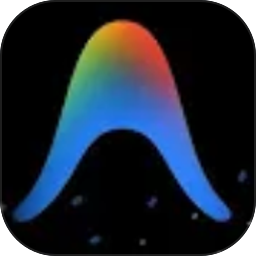

# Antigravity CLI (agy) Agent Plugin

<div align="center">
  
  <p>Local Antigravity CLI (<code>agy</code>) execution driver & Agent Provider for <a href="https://github.com/RipleyGit/open-cloude-agent">open-cloude-agent</a></p>
</div>

---

## 🌟 概述

`cloude-agent-agycli` 是为 `open-cloude-agent` 打造的官方 Antigravity CLI（在项目中简称 `agy`）Agent 插件，作为系统一级 Agent Provider 接入：

- **深度系统集成**：作为一级 Agent Provider 与 Claude、Cursor 等并列，直接在主聊天窗口、模型选择器、会话抽屉中使用。
- **Gemini 模型矩阵**：原生支持 `gemini-2.5-pro`、`gemini-2.5-flash`、`gemini-3.8-flash-low`。
- **会话双向同步**：自动跟踪本地 `~/.gemini/antigravity-cli/brain` 会话记录。
- **健康检测与探针**：自动探针本地 `agy` CLI 安装状态及运行版本。

## 📦 安装方式

### 方式一：在 open-cloude-agent 界面中一键安装
1. 打开 open-cloude-agent 界面，进入 **设置 -> 智能体**。
2. 点击 **+ 安装 Agent**。
3. 在推荐列表中找到 **Antigravity CLI**（简称 `agy`），点击 **一键安装** 即可。

### 方式二：通过 Git URL 安装
在 **安装 Agent 插件** 弹窗中输入本仓库地址：
```text
https://github.com/RipleyGit/cloude-agent-agycli.git
```

## 📄 License
AGPL-3.0-or-later
